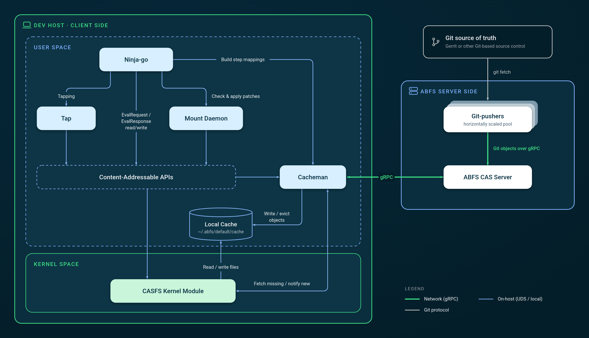

# ABFS Architecture

Another Build File Service (ABFS) is a content-addressable filesystem and build caching stack designed to accelerate source checkouts, incremental builds, and parallel workspaces across massive Git repositories.

Every file, directory tree, workspace snapshot, and build artifact in ABFS is addressed by its Git SHA content hash and stored using Git's object model. Sharing a single content-addressable model across the kernel filesystem, local cache, build executor, and remote server lets clients stream only the bytes a build or tool actually touches while reusing cached build actions safely across Continuous Integration (CI) and developer machines.



## Android as an example

In the Android build system, developers define build rules in Blueprint files (`Android.bp`), Soong compiles them into Ninja files, and [Ninja](https://ninja-build.org/) executes the final build graph (see the [Android build overview](https://source.android.com/docs/setup/build)). Similar to the [Make build tool](https://www.gnu.org/software/make/), Ninja is **timestamp-based**. If a build step’s input file is newer than the existing output file, Ninja rebuilds the output file.

When every input and output is declared in `Android.bp`, local incremental builds (building, making a code change, and rebuilding) work very well with remote execution of build actions. However, in a codebase of Android’s age, complexity, and rate of change, there are issues with some build steps.  

* **Hidden dependencies** \- Build steps read files that were never declared in the build graph.  
* **Over-declared dependencies** \- Ninja waits unnecessarily on files that aren’t ever read, which slows down builds.  
* **Undeclared outputs** \- Build steps write to files that are not declared in the build graph. Subsequent build steps may then depend on these undeclared outputs, introducing a build race condition.

When developers add thousands of new build rules across their Android code, it is difficult to find and fix these problems at scale.

For example, a build rule might pass a schema file to a compiler inside raw string flags rather than declaring it in `srcs`:

```
// Android.bp excerpt showing a hidden dependency on v1.json
java_library {
    name: "my-service",
    srcs: ["src/**/*.java"],
    javacflags: ["-Aschema.location=schemas/v1.json"],
}
```

The Ninja build graph properly records `src/**/*.java` as inputs to this build step. However, since `javacflags` is just a list of arbitrary strings, the compiler reads `v1.json` from disk but it isn’t recorded as an input in the build graph. If a developer edits only `v1.json` and runs an incremental build with `m my-service`, a timestamp-based build would check only the `.java` files, see none are newer than the output `.jar`, and silently skip rebuilding. This build step and all steps that depend on it are now broken for incremental builds.

ABFS is designed around **prioritizing correctness over speed**: a cached or incremental build is only useful if its output matches a clean build. As described below, ABFS combines kernel-level I/O *tapping* with *two-phase build caching* to stay fast without sacrificing clean-build correctness.

## Client-Side Components

### Filesystem (CASFS)

At the core of client-side ABFS is a virtual filesystem called [Content-Addressable Storage Filesystem (CASFS)](https://github.com/google/abfs-casfs), implemented as a Linux kernel module. CASFS supports all standard POSIX filesystem operations needed to check out, edit, and build source code, while exposing the content hashes of files and directories via extended attributes.

ABFS uses Git's SHA hash as its primary digest algorithm and Git's object model for storage:

```sh
# write a file
$ echo world > hello1
# read the CASFS hash
$ abfs hash hello1
cc628ccd10742baea8241c5924df992b5c019f71
# same hash as git
$ git hash-object hello1
cc628ccd10742baea8241c5924df992b5c019f71
```

When a file's hash is set via CASFS, its content is **lazy-loaded** only when a process actually reads the file. Another machine or mount can materialize the file entry immediately using only its hash and metadata:

```sh
# create an empty file
$ touch hello2
# set the file hash (metadata only; content is not downloaded yet)
$ abfs hash --set cc628ccd10742baea8241c5924df992b5c019f71 hello2
# stat/ls reads filename, permissions, and size without fetching file content
$ ls -l hello2
-rw-r----- 1 user primarygroup 6 Nov  3 00:11 hello2
# content is lazy-loaded on first read
$ cat hello2
world
```

Lazy loading allows an initial `abfs mount` checkout to transfer only lightweight directory trees and file metadata prepopulated with Git content hashes, deferring blob downloads until a developer tool, compiler, or agent reads each file.

### Tapping and Tap

CASFS can record every file and directory that a process tree reads, writes, or deletes during execution—a mechanism called *tapping*. When a build step misses in the build cache, it runs on CASFS with tapping enabled so ABFS can observe the step's true filesystem footprint, including any hidden dependencies or over-declared inputs. These recorded file lists, called *patches*, are stored in the cache alongside the step's output artifacts.

The **Tap** component (`cmd/tap`) is a lightweight user-space helper binary that configures CASFS tapping for a command and serializes the resulting patches, keeping JSON formatting and higher-level build logic out of the kernel module.

### Mount Daemon

One user-space **Mount Daemon** (`casfs-mounter`) process runs in the background for each mounted CASFS directory created by `abfs mount`. Keeping complex, multi-file operations—such as bulk checking read patches against a mount or applying write patches from cached build steps—in user space keeps the CASFS kernel module small and focused.

### Two-Phase Build Caching with Ninja-go

Instead of relying on file modification timestamps, build tools running on ABFS query content hashes directly from CASFS. [Ninja-go](https://github.com/google/ninja-go) is a Ninja-compatible build executor extended by ABFS (`ninjago/`) to perform **two-phase content-addressable caching**:

1. **Phase 1 – Declared key lookup:** Ninja-go treats each build step as a pure function, combining its command line, relevant environment variables, declared input paths, and declared input content hashes into a lookup key (`EvalRequest`) for the build cache. If a prior CI or developer build has executed that step, one or more candidate results (`EvalResponse`) are returned.
2. **Phase 2 – Read-patch verification:** Before accepting and applying a Phase 1 candidate result, ABFS asks the Mount Daemon to verify the candidate's recorded `ReadPatch` (the exact files and directories read during prior execution) against the current CASFS filesystem state.
   * In the common case where all read hashes match, ABFS applies the candidate's `WritePatch` directly to CASFS—populating output file hashes without downloading output bytes unless a downstream step reads them.
   * If any entry in `ReadPatch` differs from the current mount (for instance, because an undeclared hidden dependency was edited), ABFS rejects that candidate. If no candidates match, Ninja-go executes the step locally with CASFS tapping enabled and records the new `EvalResponse`.

Returning to the `my-service` example above with an undeclared dependency on `schemas/v1.json`, here is what a conceptual Phase 1 `EvalRequest` and Phase 2 `EvalResponse` look like:

```jsonc
// Phase 1: excerpt of an EvalRequest computed from declared inputs and outputs
{
  "Command": "javac -proc:only -Aschema.location=schemas/v1.json src/Main.java -o out/my-service.jar",
  "EnvVars": {
    "JAVA_HOME": "prebuilts/jdk/jdk25/linux-x86",
    "TMPDIR": "out/soong/.temp"
  },
  "Targets": ["out/my-service.jar"],
  "InputPatch": [
    { "Path": "src/Main.java", "Hash": "a1b2c3..." }
    // Note: schemas/v1.json is missing here because it wasn't declared in Android.bp
  ]
}
```

```jsonc
// Phase 2: excerpt of a candidate EvalResponse recorded by CASFS tapping during a prior build
{
  "ExitCode": 0,
  "ReadPatch": [
    { "Path": "src/Main.java",   "Hash": "a1b2c3..." },
    { "Path": "schemas/v1.json", "Hash": "9f8e7d..." } // discovered via CASFS tapping
  ],
  "WritePatch": [
    { "Path": "out/my-service.jar", "Hash": "3c4d5e..." }
  ]
}
```

If a developer modifies `schemas/v1.json`, the Phase 1 `EvalRequest` still hashes to the same lookup key because none of the declared inputs changed. In Phase 2, however, ABFS checks `ReadPatch` against the current CASFS mount, sees that `schemas/v1.json` no longer matches `9f8e7d...`, rejects the stale `EvalResponse`, and reruns `javac` to preserve clean-build correctness. See the [ABFS Expert / Build Hygienist guide](abfs-expert/README.md) for tools (`abfs inspect`, `abfs diff`, and `out/.ninja_log`) that surface mismatches and help teams fix hidden or non-deterministic dependencies in their build graphs.

Ninja-go targets build systems that emit Ninja build files, such as Android (Soong) and Chromium. Other build systems can integrate with ABFS's content-addressable and caching APIs using the same model; see [`cmd/abfs-bazel-daemon`](../cmd/abfs-bazel-daemon/README.md) for an experimental Bazel integration.

### Cacheman and Local Cache

The cache manager daemon, **Cacheman**, owns the on-host object cache (by default `~/.abfs/default/cache`) and handles all network communication with the remote ABFS server over gRPC:

* **Lazy fetches:** When a process reads an unloaded file on CASFS, the kernel module requests the object hash from Cacheman over a local Unix Domain Socket (UDS). On a local cache miss, Cacheman fetches the blob from the ABFS CAS Server, stores it in the local cache directory, and replies to CASFS so the file can be read directly from local storage.
* **Write lifecycle and LRU eviction:** When a new or modified file is written inside a CASFS mount and its hash is computed, CASFS notifies Cacheman over the UDS so Cacheman can track the object in its Least Recently Used (LRU) cache, evict cold objects when the configured cache limit is reached, and upload workspace or build objects to the ABFS CAS Server as needed.

Multiple CASFS mounts on the same host share a single Cacheman instance and local cache, deduplicating source blobs and build artifacts across concurrent branches and workspaces.

## Server-Side Components

### ABFS CAS Server

The **ABFS CAS Server** exposes a [gRPC](https://grpc.io/) service that indexes and serves:

* **Content-addressable objects:** Git commits, trees, source blobs, build outputs, and ABFS metadata objects (`EvalRequest`, `EvalResponse`, patch trees, and build logs).
* **References:** Upstream Git branch refs and persistent developer workspace snapshot refs.
* **Build step mappings:** The Phase 1 function map associating `EvalRequest` hashes with candidate `EvalResponse` hashes.

ABFS includes an in-memory server implementation for testing, an open-source file-based disk implementation (see the [System Admin guide](sysadmin/README.md)), and a horizontally scalable Google Cloud implementation undergoing external documentation and testing. Because clients stream blobs on demand and skip downloading intermediate build outputs that are never read locally, an ABFS checkout and cached build transfers substantially less network data than a traditional `repo sync`, though low-latency connectivity to the CAS Server remains important when warming an empty local cache.

### Git-pushers

**Git-pushers** (`cmd/abfs/git-pusher`) run as a horizontally scaled pool of workers that monitor Gerrit or other Git hosts, fetch new commits, trees, blobs, and branch refs across all projects in a manifest, and upload those Git objects into the ABFS CAS Server over gRPC. Pre-populating the CAS Server decouples client checkouts from the upstream Git host, avoiding Gerrit rate limits and allowing `abfs mount` to resolve an entire multi-thousand-repository manifest directly from the CAS Server in seconds.

## End-to-End Workflow Capabilities

### How the Pieces Fit Together

1. **Ingest:** Git-pushers keep the ABFS CAS Server continuously synchronized with upstream Git repositories, while CI builds populate shared `EvalRequest` → `EvalResponse` mappings and build artifacts.
2. **Mount:** `abfs mount` creates a CASFS directory tree populated with file metadata and Git SHA hashes. Source blobs remain on the server until read through Cacheman.
3. **Edit & Sync (Synchronized Workspaces):** Each mount can attach to a named *workspace* (see [ABFS Workspaces](android-dev/WORKSPACES.md)). Edits to source files, `.git` state, and `.repo` state are hashed on CASFS and eagerly synced via Cacheman to the ABFS CAS Server, keeping a workspace persisted across sessions or synchronized across multiple mounts on one or more hosts.
4. **Git-Native Operations:** Because CASFS speaks Git's object model and SHA digest format natively, missing commits, trees, and blobs inside `.git` directories are lazily fetched by hash on demand, allowing standard `git` and `repo` workflows to operate transparently inside an ABFS mount.
5. **Build:** Ninja-go evaluates the build graph using two-phase caching—applying verified `WritePatch` hashes on cache hits and running cache misses under CASFS tapping so subsequent builds reuse the results.
