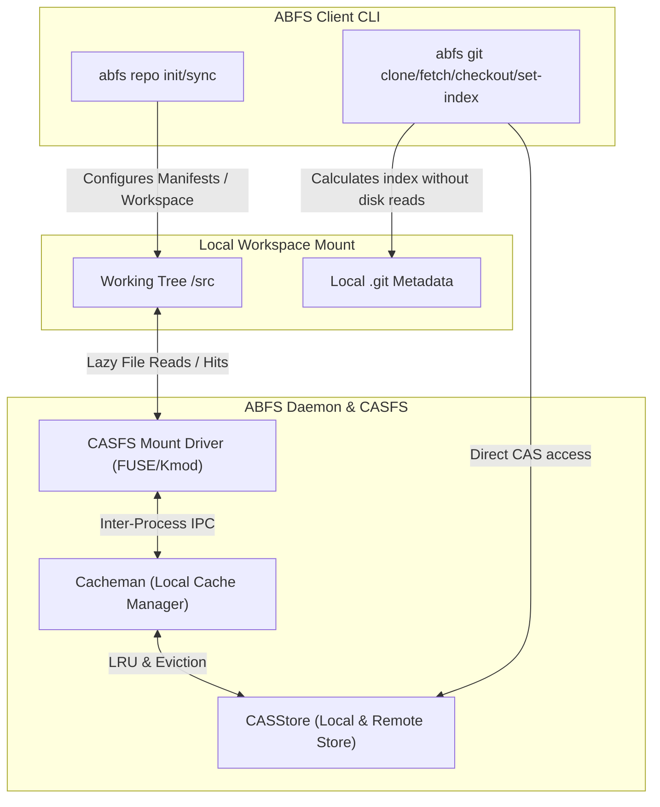

# ABFS Repo and ABFS Git Concepts

This document explains the `abfs repo` and `abfs git` command suites, their underlying concepts, how they integrate with **Another Build File Service (ABFS)**, and how they optimize Git operations for a lazy-loaded, content-addressable storage filesystem.

---

## Overview of the Challenge

In standard development, Git is designed for local, complete filesystems where every file, blob, tree, and commit history is fully downloaded and present on the disk. 

When using a lazy-loaded filesystem like **CASFS** (Content Addressable Storage File System) served by ABFS:
1. Files are fetched from the remote CAS store **on demand** (only when accessed).
2. Operations like standard `git status`, `git diff`, or checking out branches can cause the filesystem to read all files to compute their hashes or check `mtime` modifications.
3. This "naive" scanning triggers ABFS to download gigabytes of source code files unnecessarily, defeating the core performance benefits of a virtualized filesystem.

To solve this, ABFS introduces **CAS-aware Git and Repo clients**:
- **`abfs repo`**: A drop-in replacement/wrapper for the Google `repo` tool, enabling multi-project workspace management optimized for CASFS.
- **`abfs git`**: A suite of developer tools and optimized versions of Git commands (`clone`, `fetch`, `checkout`, `set-index`) that bypass traditional disk/hashing overhead by interacting directly with the CASStore and `DeepTree` metadata.

---

## Architecture & Data Flow

The following diagram visualizes how `abfs repo` and `abfs git` interact with the local cache, the running daemon, and the remote CAS store:

---

## `abfs repo`: Multi-Repository Workspace Management

`abfs repo` provides workspace orchestration for multi-git repositories as defined by Android repo XML manifests. It is designed to replace `repo init` and `repo sync` with highly parallelized, CAS-aware execution.

### Subcommands

#### 1. `abfs repo init`
Initializes a multi-repository workspace in the current directory.
- **What it does**: 
  - Creates the `.repo/` metadata directory.
  - Clones and flattens the remote XML manifest branch.
  - Generates a `.repo/mount-details` symlink pointing to the CASFS root mount, ensuring building tools (like Soong) can communicate with the active mount.

#### 2. `abfs repo sync`
Synchronizes the workspace projects to the versions specified in the manifest.
- **What it does**:
  - **Parallel Synced Checkouts**: Orchestrates parallel checkout of hundreds of projects directly using ABFS-aware Git logic (`casgit`).
  - **Link/Copy File Support**: Handles the `<linkfile>` and `<copyfile>` manifest actions without copying actual data blocks; instead, it writes references in `copy-link-files.json` and manages clean local symlinks.
  - **Content Prefetching**: Uses `Cacheman` to run background high-priority prefetching (`prefetchContent`) for critical directory paths specified by `SyncPrefetchDirs` (e.g., build files, Soong blueprints).
  - **Automated Setup**: Runs build-system helpers (`abfs setup`) to configure tools to build AOSP using ABFS-optimized utilities (like `ninjago`).

---

## `abfs git`: CAS-Optimized Git Operations

`abfs git` is a collection of tools designed to bypass traditional Git's disk-bound scanning. By using the local `casgit` package, it speaks Git's internal object model directly on top of the content-addressable `CASStore`.

### Subcommands

#### 1. `abfs git clone`
Clones a remote Git repository directly into a CASFS mount.
- **Key Advantage**: It sets up the directory structure (optionally in "repo manner" with custom bare layout references) and populates the working tree with lazy-load placeholders. File contents are not fetched until a reader opens them.

#### 2. `abfs git fetch`
Fetches branches, references, and pack indexes from remote repositories.
- **Key Advantage**: References and commit history are stored in the CASStore immediately. The actual file contents (blobs) are left on the server to be retrieved dynamically when accessed.

#### 3. `abfs git checkout`
Switches branches or restores working tree files.
- **Key Advantage**: Performs the index modification and directory-level state shifts without checking out raw bytes or scanning unchanged files.

#### 4. `abfs git set-index`
The **most critical performance optimization** in the ABFS Git suite.
- **The Problem**: Traditional `git` tracks files using `mtime` and file size inside the `.git/index` file. When files are lazy-loaded or touch attributes change, `git status` sees a mismatch. To verify, Git reads every file from the disk to calculate its SHA1. On a lazy-loaded filesystem, this forces the download of the *entire* repository.
- **The Solution**: `set-index` takes a target revision (commit or tree-ish SHA) and generates a pre-compiled Git `.git/index` file directly from the CAS `DeepTree` object metadata and the local filesystem's OS `stat` info.
- **Why it works**: Because the generated index entries contain the *precise* SHA1s from the DeepTree alongside the *precise* `mtime`, `ino`, and `size` of the local files, Git assumes the files are completely up-to-date and unmodified. **Zero file reads or network downloads are triggered!**

---

## Technical Details: How CASGit & DeepTree Work

The `casgit` package acts as the backend engine for these commands:
- It reads Git commits, tags, and trees directly from the `CASStore` by decoding Git objects.
- It handles complex Git object structures like **DeepTree** (`gitobjects.DeepTreeObject`) which represent large hierarchal directories in a flattened list format for fast lookup.
- It interfaces with `Cacheman` to manage caching, prefetching, and tracking local modifications.

### Direct Comparison

| Operation | Traditional Git / Repo | ABFS Git / Repo |
| :--- | :--- | :--- |
| **`clone`** | Downloads all commits, trees, and file payloads. | Downloads references and trees; files are virtualized. |
| **`sync`** | Iteratively fetches and fully checks out all manifest projects. | Parallel CAS-aware checkouts; background prefetches build configs. |
| **`status`** | Computes SHA1 of files whose `mtime` changed. | Uses `set-index` to bypass scanning by aligning index & stats. |
| **Storage** | Local disk has complete copies of all blobs. | On-demand caching; unused files evicted via LRU. |
