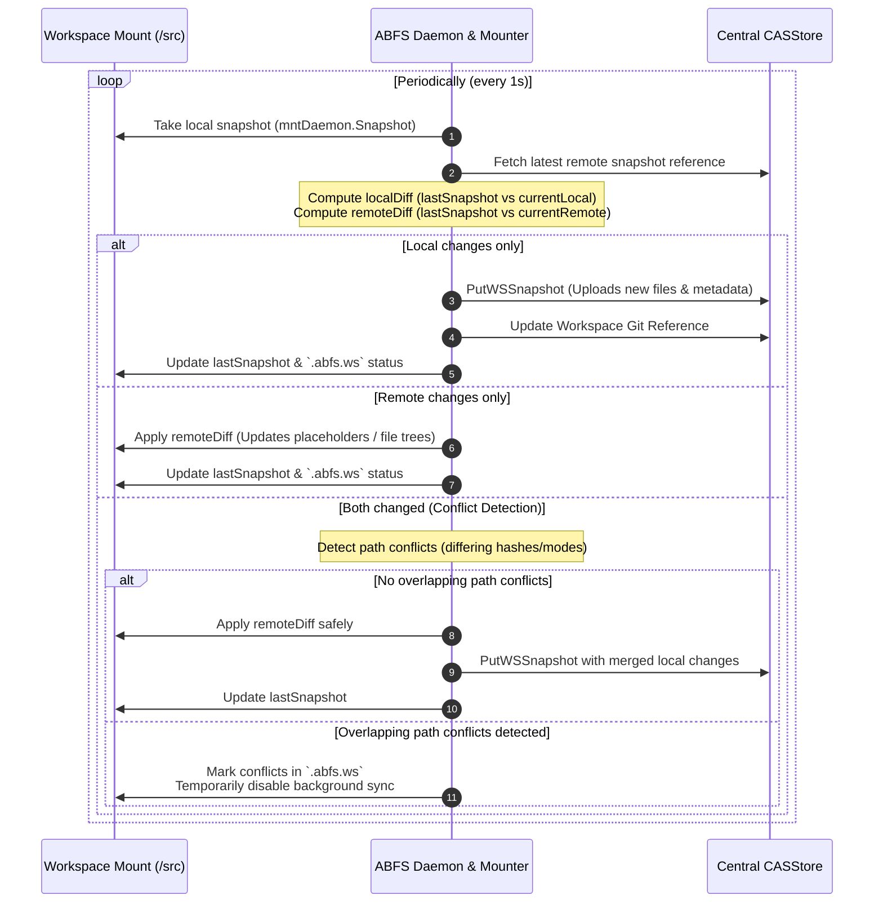

# ABFS Workspaces

This document explains the concept of **ABFS Workspaces**, how they enable state-synchronized, collaborative virtual development on top of a lazy-loaded filesystem, and how to use the `abfs ws` command suite to manage them.

---

## The Concept: What is an ABFS Workspace?

In traditional software engineering, developer workspaces are strictly local. Your files, git repositories, build outputs, and changes exist only on your hard drive until committed and pushed to a central host like Gerrit or GitHub.

Under **Another Build File Service (ABFS)**, a workspace is a first-class, virtualized entity managed directly by the filesystem and synchronized via the content-addressable storage service. 

An ABFS Workspace:
1. **Virtualizes Development State**: It tracks the entire state of a directory—including nested Git repositories (working tree hashes, `.git` metadata, and Git packs)—as metadata objects stored in CAS.
2. **Synchronizes Dynamically**: A background sync daemon monitors the local workspace mount, periodically capturing state snapshots. It automatically uploads local modifications to the CASStore and downloads/applies remote updates from other instances of the same workspace.
3. **Decouples State from Hardware**: Because the workspace state is stored centrally in the CASStore, you can detach from a workspace on one machine and attach to it on another, seamlessly resuming your work with identical files, branches, and untracked modifications.

### The Workspace Status File (`.abfs.ws`)

Every active workspace contains a state metadata file called `.abfs.ws` at its root path.
* This file is automatically generated and kept up-to-date by the ABFS mount.
* It is marked as **CASFS-excluded**, meaning changes to it do not trigger standard CAS synchronization overhead or bloat the tree.
* It contains tracking metadata such as the workspace name, the last snapshot hash, last update/push timestamps, and active conflicts.

---

## Architecture & State Synchronization

The state of an ABFS workspace is persisted under a central Git reference in the CASStore metadata project:
`refs/abfs/ws/user/{user}/{workspace-name}`

This Git reference points to a **`WSSnapshot`** object, which is a versioned CAS object containing:
* **Root**: A CAS directory tree hash representing the workspace root's standard files.
* **GitRepos**: A list of snapshots for every nested Git repository, capturing the `WorkDir`, `GitDir`, and `ObjectsDir` paths along with their exact CAS hashes (`WorkDirHash`, `GitDirHash`, `PacksHash`).

### State Synchronization Flow

The following sequence diagram illustrates the background synchronization mechanism:



---

## Workspace Subcommands

All workspace operations are grouped under the `abfs ws` command namespace (aliases: `work`, `workspace`).

### 1. Print Current Workspace Status
Print information about the active workspace corresponding to the current directory.

* **Usage**: `abfs ws [path]`
* **Flags**:
  * `-l, --long`: Print in a verbose format, showing the active mount path, conflicts list, last update timestamp, and snapshot hash.

```bash
# Print short status
$ abfs ws
Workspace: my-active-workspace

# Print detailed status
$ abfs ws -l
Workspace:      my-active-workspace
Path:           /src
Conflicts:
                build/make/core/main.mk
Last Update:    2026-05-18 20:50:12 -0700 PDT
Snapshot Hash:  eb2ae649e8b4be7a70100013a9f8b51229285207
```

---

### 2. Create a New Workspace (`new`)
Initialize a fresh workspace and attach it to a directory.

* **Usage**: `abfs ws new <ws-name> [<work-dir>]`
* **Default**: If `<work-dir>` is omitted, defaults to the current directory `.`.
* **What it does**: Instantiates a new workspace in the CASStore and establishes the local `.abfs.ws` tracking file in `<work-dir>`.

```bash
$ abfs ws new feature-auth /src
```

---

### 3. Attach an Existing Workspace (`attach`)
Resumes or binds an existing remote workspace to a local directory.

* **Usage**: `abfs ws attach <ws-name> [<work-dir>] [-s <strategy>]`
* **Conflict Resolution Strategies**:
  * `exact-match` (Default): The local tree must precisely match the remote snapshot.
  * `local-wins`: Overwrite remote changes with the current local filesystem state.
  * `remote-wins`: Overwrite local modifications with the state fetched from the CASStore.

```bash
$ abfs ws attach feature-auth /src -s remote-wins
```

---

### 4. Detach a Workspace (`detach`)
Unbinds the workspace from the local mount directory.

* **Usage**: `abfs ws detach [<work-dir>] [-f]`
* **Flags**:
  * `-f, --force`: Detach immediately without prompting for user confirmation.
* **What it does**: Cleans up the local workspace tracking `.abfs.ws` file while leaving the remote workspace snapshot intact in the CASStore.

```bash
$ abfs ws detach /src
Detach workspace "feature-auth" from "/src"? [y/N]: y
Detached from workspace 'feature-auth'.
```

---

### 5. List Workspaces (`list`)
Lists all workspaces registered in the CASStore for the current OS user.

* **Usage**: `abfs ws list` (or `abfs ws ls`)
* **Flags**:
  * `-l, --long`: Output both the workspace name and its latest remote snapshot hash.

```bash
$ abfs ws list -l
eb2ae649e8b4be7a70100013a9f8b51229285207 feature-auth
8c3aa14fde428e5ea87a428c24707a1b196dc0ff bugfix-102
```

---

### 6. Clone a Workspace (`clone`)
Duplicates the state snapshot of an existing workspace under a new name in the CASStore.

* **Usage**: `abfs ws clone <ws-name> <new-ws>`
* **What it does**: Reads the remote ref for `<ws-name>` and registers a new ref pointing to the same snapshot hash under `<new-ws>`, allowing you to branch your virtualized workspace.

```bash
$ abfs ws clone feature-auth feature-auth-experimental
```

---

### 7. Remove a Workspace (`remove`)
Deletes the remote workspace reference from the CASStore.

* **Usage**: `abfs ws remove <workspace-name>` (or `abfs ws rm`)
* **Flags**:
  * `-f, --force`: Skip user confirmation.

```bash
$ abfs ws remove bugfix-102
Remove workspace "bugfix-102" with snapshot 8c3aa14fde428e5ea87a428c24707a1b196dc0ff? [y/N]: y
Workspace 'bugfix-102' removed.
```

---

### 8. Mount a Workspace (`mount`)
Mounts the filesystem for an existing workspace onto a target mount path and starts the background synchronizer daemon.

* **Usage**: `abfs ws mount <workspace> <path>`
* **Flags**:
  * `--foreground`: Runs the mounting CASFS daemon in the foreground rather than daemonizing it.

```bash
$ abfs ws mount feature-auth /src
```

---

### 9. Bootstrapping a Multi-Repo Workspace (`mount-repo`)
An all-in-one command that creates/restores a workspace, configures a CASFS mount, and initializes/syncs a multi-repository layout based on Android's `repo` manifest XMLs.

* **Usage**: `abfs ws mount-repo [--ws <name> | --tmp-ws] [-b <branch> | -h <manifest-hash>] <mnt-point>`
* **Flags**:
  * `--ws <name>`: Mount and sync using an existing workspace name.
  * `-t, --tmp-ws`: Create a transient workspace.
  * `-b, --branch`: Specify the manifest git branch (e.g., `main`).
  * `-h, --manifest-hash`: Pin the mount to a specific manifest XML blob hash.
  * `-g, --groups`: Filter manifest projects (identical to `repo init -g`).
  * `--foreground`: Run CASFS daemon in the foreground.

```bash
$ abfs ws mount-repo --ws feature-auth -b main /src
```

---

### 10. Resolve Conflicts (`resolve`)
Marks conflicting workspace paths as resolved, clearing them from the `.abfs.ws` conflict register so that background synchronization can resume.

* **Usage**: `abfs ws resolve <path>...`

```bash
$ abfs ws resolve build/make/core/main.mk
```

---

## Direct Comparison: Traditional vs ABFS Workspaces

| Feature | Traditional Local Workspace | ABFS Virtual Workspace |
| :--- | :--- | :--- |
| **Storage Location** | Local Hard Disk. | Centrally in **CASStore** (only accessed files cached locally). |
| **Sync Mechanism** | Manual (`git push`/`git pull` or patch files). | Automated, real-time background synchronization loop. |
| **Hardware Decoupling** | None (locked to the local machine). | **Fully Decoupled** (can attach/detach to resume state anywhere). |
| **Multi-Repo Tracking** | Inconsistencies between local git trees. | **Unified Snapshot** tracking all git tree states simultaneously. |
| **Conflict Handling** | Manual merging on git pull/merge commands. | Automatic path conflict identification flagged in `.abfs.ws`. |
